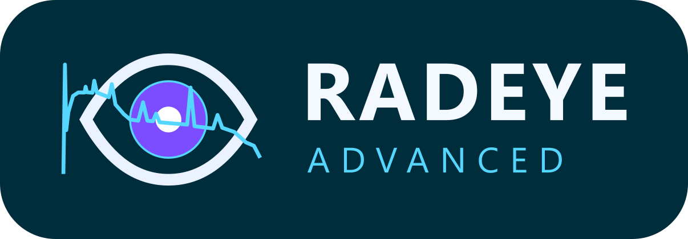
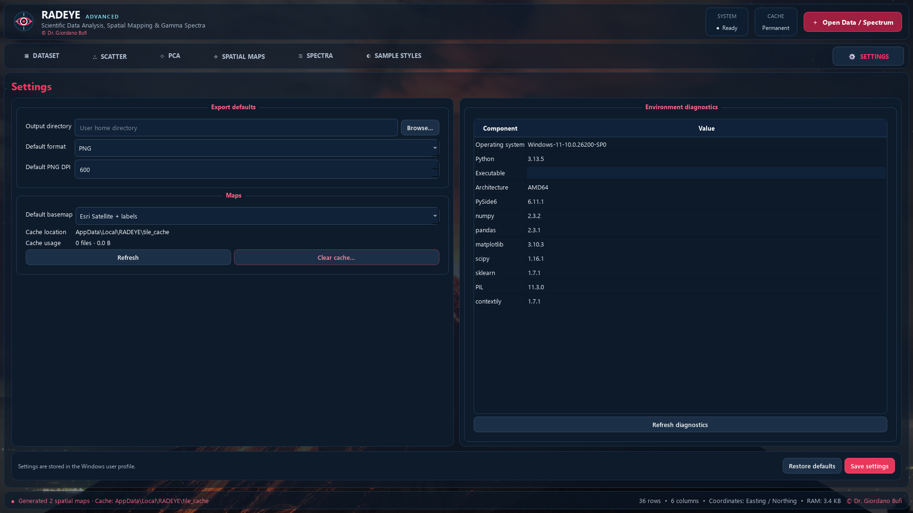

# RADEYE Advanced

Which field samples resemble one another? Where do the highest readings occur? How much of a peak in a gamma spectrum comes from the signal, and how much from the background? RADEYE Advanced is a Windows desktop application for researchers exploring questions like these with field and laboratory measurements.

Start with a sample table to compare measurements, uncover patterns across several variables and see where those patterns occur on a map. Or open a detector spectrum to work directly with the peaks behind a measurement. The short demonstration follows that second workflow, from selecting a peak to reviewing how closely the fitted curve follows the observed counts.

**[Watch the Spectra demonstration (MP4, 3 min 2 s)](media/demo-radeye.mp4)** · [Credits and acknowledgements](CREDITS.md)

https://github.com/user-attachments/assets/4414434d-70cb-46f5-99df-a602195acc5e

[Dataset](#dataset) · [Scatter](#scatter) · [PCA](#pca) · [Spatial Maps](#spatial-maps) · [Spectra](#spectra) · [Sample Styles](#sample-styles) · [Settings](#settings)

## Dataset

**Get to know the samples behind the numbers.** In the survey shown below, each row connects a sample name to three count rates and a sampling location. Open an Excel workbook or a CSV, TXT or TSV table to check how RADEYE reads your data. The preview shows the column headings and up to 500 rows, alongside the total sample and variable counts. You can spot a missing coordinate or check that the right version of a survey is open before you plot it.

That one table serves three purposes. Scatter compares pairs of measurements, PCA examines several together, and Spatial Maps uses the coordinates to place them in the field. If your measurements have standard deviations, you can carry those into Scatter as error bars. Recent datasets are available when you return to the project.

## Scatter

**Do two measurements rise together?** The example below compares lead-212 and bismuth-214 count rates. Each point is a sample. The fitted line summarises the overall relationship, while the spread around it helps you pick out samples worth a closer look. Select a subset of samples, overlay as many as three other datasets to compare field campaigns, or add a third variable and rotate the point cloud to see whether groups that overlap in 2D separate in 3D.

For a closer look at the trend, fit a straight line or a polynomial, exponential or logarithmic curve. Open the fit details to see the equation, its parameters and R². If both measurements have uncertainties, York regression can account for errors on both axes and their correlation. When two datasets have different slopes, the alignment tools report the slope ratio and angle between the lines. You can preview a rotation about the origin or the centre of the samples, then export the transformed coordinates with their uncertainties.

## PCA

**Which samples look alike when you consider several measurements at once?** Principal component analysis (PCA) helps you explore that question on a single plot. In the example, RADEYE combines three isotope count rates. Samples close together have similar profiles along the displayed components. The arrows show which measurements drive the separation, and the percentage on each axis tells you how much of the variation that view captures.

Choose the samples and variables to include, explore different component pairs or rotate the 3D view. Confidence ellipses help you read the spread of the scores. Two complementary diagnostics highlight samples at the extremes of the main pattern and those poorly represented by it. Contribution plots help you investigate individual flagged samples. For reporting, copy or export the table of component weights, eigenvalues and explained variance directly from the analysis.

## Spatial Maps

**Where did you measure, and what changes across the area?** Start with a point map to check where samples were collected, how closely sites are spaced and where there are gaps. Sample names, a local scale bar and an orientation marker help you read the survey in context. You can work with geographic coordinates on a basemap or use a local grid measured in metres.

Then choose a measurement to estimate how its values vary between sites. The example shows two count rates side by side, with the original sampling points visible over each estimated surface. You can compare interpolation methods, trace contours and limit the surface to the area enclosed by the samples. Adjusting the colour range can reveal a gradual change that a single extreme reading would otherwise obscure. Save each map separately or export the group as one figure.

## Spectra

**How much signal belongs to a particular gamma peak?** The screenshot shows a lead-212 peak near 238 keV. The stepped trace is what the detector recorded. The other curves show the fitted peak, the estimated local background and their sum. The lower panel shows where the observations fall above or below the fit and by how much relative to their uncertainty. You can see where a fit deserves a second look before using its net area.

- **Find a peak and establish its energy.** Open a TXT, LIS or SPE acquisition, inspect counts and live time, and explore weak and strong peaks on linear or logarithmic scales. Group detector channels if needed. Mark a region yourself or use the automatic peak finder, then compare candidates with the reference catalogue. Known peaks let you calibrate the energy scale and check the residuals before switching from detector channels to keV.
- **Measure a peak, including one with a neighbour.** Fit a single peak or overlapping peaks against a local background. Adjust the allowed position, height or width, inspect the individual components and review the centroid, width, net area and uncertainty. An experimental Monte Carlo diagnostic offers a second estimate of area uncertainty. Saved regions and fit constraints can be reused, and an existing energy calibration stays in place when you refit.
- **Compare acquisitions and account for background.** Overlay two spectra to see whether a feature has shifted. Subtract a measured background, including a separately calibrated blank, and compare the result with the raw counts. For compatible repeat acquisitions, combine counts over their shared energy range and save the summed spectrum.
- **Take the result back to the lab.** Save a project to reopen the spectrum with its peak assignments, fits and background settings. Export a calibrated spectrum as SPE or LIS, or take the results into Excel with peak areas, count rates and their uncertainties when live time is available.

## Sample Styles

**Make the same sample group recognisable from one figure to the next.** In the example below, ridge, slope and valley samples each have a distinct colour and marker. You can give a whole sampling campaign one appearance using a shared name prefix, then give a single reference sample its own outline. A live preview shows which rule matches each sample, so you can adjust the order before generating the figures.

This is where figure design fits into the workflow. Sample Styles keeps group identities consistent, while the individual plotting tools offer controls for titles, labels, legends, fonts, lines, grids, backgrounds and colour maps. Export a PNG at the resolution you need for a slide, or a PDF or SVG that stays sharp when resized for a paper or poster.

## Settings

**Set up the next session the way you work.** If your team prepares report figures at a particular resolution or uses the same basemap for every survey, save those choices once. RADEYE remembers the default export folder, image format, PNG resolution and basemap between sessions.

For mapping work, you can check how much disk space downloaded map tiles occupy and clear them when needed. If a colleague needs to reproduce your setup or help troubleshoot a problem, the diagnostics panel gathers the operating system, Python version and scientific library versions in one place.

## Contact

For more info, contact [gbufi.chem@gmail.com](mailto:gbufi.chem@gmail.com).
